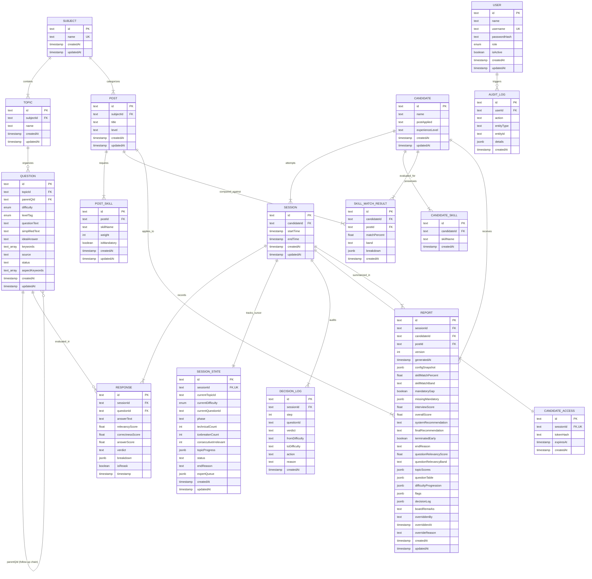

# 2. Entity-Relationship (ER) Diagram & Data Modelling

## A. Visual ER Diagram (Mermaid Notation)



---

## B. ASCII Architecture Diagram

```
+-------------------------------------------------------------------------------------------------------------------+
|                                                 CURRICULUM DOMAIN                                                 |
|                                                                                                                   |
|   +---------------+ 1         N +-------------+ 1         N +------------------+                                  |
|   |    SUBJECT    |------------>|    TOPIC    |------------>|     QUESTION     |                                  |
|   +---------------+             +-------------+             +------------------+                                  |
|           | 1                                                 | 1          ^                                      |
|           |                                                   |            | parentQId (Recursive 1:N)            |
|           | N                                                 |            +--------------------------+           |
|           v                                                   | N                                     |           |
|   +---------------+ 1         N +-------------+               v                                       |           |
|   |     POST      |------------>|  POST_SKILL |         +------------------+                          |           |
|   +---------------+             +-------------+         |     RESPONSE     |                          |           |
|           | 1                                           +------------------+                          |           |
|           |                                                   | N                                     |           |
|           | N                                                 |                                       |           |
|           v                                                   v 1                                     |           |
|   +--------------------+ 1    N +-------------+ 1         N +------------------+ 1         1 +------------------+ |
|   | SKILL_MATCH_RESULT |<-------|  CANDIDATE  |------------>|     SESSION      |------------>|  SESSION_STATE   | |
|   +--------------------+        +-------------+             +------------------+             +------------------+ |
|                                       | 1                     | 1          | 1                                    |
|                                       |                       |            |                                      |
|                                       | N                     | N          v 1                                    |
|                                       v                       |     +------------------+                          |
|                                 +-------------+               |     | CANDIDATE_ACCESS |                          |
|                                 | CAND_SKILL  |               |     +------------------+                          |
|                                 +-------------+               v                                                   |
|                                                         +------------------+                                      |
|                                                         |   DECISION_LOG   |                                      |
|                                                         +------------------+                                      |
|                                                                                                                   |
|                                                 GOVERNANCE DOMAIN                                                 |
|                                                                                                                   |
|           +---------------------------------------------------------------------------------------+               |
|           |                                        REPORT                                         |               |
|           | (SessionId FK, CandidateId FK, PostId FK, Composite UNIQUE: [sessionId, version])     |               |
|           +---------------------------------------------------------------------------------------+               |
|                                                                                                                   |
|                                 +-------------+ 1         N +------------------+                          |
|                                 |    USER     |------------>|    AUDIT_LOG     |                          |
|                                 +-------------+             +------------------+                          |
+-------------------------------------------------------------------------------------------------------------------+
```

---

## C. Entity Attributes, Keys & Data Types

| Entity | Primary Key | Foreign Keys | Key Attributes & Enums | Constraints |
| :--- | :--- | :--- | :--- | :--- |
| **`Subject`** | `id` (UUID) | None | `name` (TEXT) | `UNIQUE(name)` |
| **`Topic`** | `id` (UUID) | `subjectId` $\to$ `Subject.id` | `name` (TEXT) | `UNIQUE(subjectId, name)`, `ON DELETE CASCADE` |
| **`Question`** | `id` (UUID) | `topicId` $\to$ `Topic.id`<br>`parentQId` $\to$ `Question.id` | `difficulty` (`EASY`, `MEDIUM`, `HARD`)<br>`levelTag` (`TECHNICAL`, `MANAGERIAL`, `ICEBREAKER`)<br>`questionText` (TEXT)<br>`simplifiedText` (TEXT)<br>`idealAnswer` (TEXT)<br>`keywords` (TEXT[])<br>`source` (`BANK`, `EXPERT`) | `INDEX(topicId, difficulty)`<br>`INDEX(parentQId)`<br>`ON DELETE SET NULL` |
| **`Candidate`** | `id` (UUID) | None | `name` (TEXT)<br>`postApplied` (TEXT)<br>`experienceLevel` (TEXT) | `INDEX(name)` |
| **`Session`** | `id` (UUID) | `candidateId` $\to$ `Candidate.id` | `startTime` (TIMESTAMP)<br>`endTime` (TIMESTAMP) | `INDEX(candidateId)`<br>`ON DELETE CASCADE` |
| **`Response`** | `id` (UUID) | `sessionId` $\to$ `Session.id`<br>`questionId` $\to$ `Question.id` | `answerText` (TEXT)<br>`relevancyScore` (FLOAT)<br>`correctnessScore` (FLOAT)<br>`answerScore` (FLOAT)<br>`verdict` (TEXT)<br>`breakdown` (JSONB)<br>`isReask` (BOOLEAN) | `UNIQUE(sessionId, questionId, isReask)`<br>`ON DELETE CASCADE` (Session)<br>`ON DELETE RESTRICT` (Question) |
| **`Post`** | `id` (UUID) | `subjectId` $\to$ `Subject.id` | `title` (TEXT)<br>`level` (TEXT) | `INDEX(subjectId)`<br>`ON DELETE CASCADE` |
| **`PostSkill`** | `id` (UUID) | `postId` $\to$ `Post.id` | `skillName` (TEXT)<br>`weight` (INT, 1–5)<br>`isMandatory` (BOOLEAN) | `UNIQUE(postId, skillName)`<br>`ON DELETE CASCADE` |
| **`CandidateSkill`**| `id` (UUID) | `candidateId` $\to$ `Candidate.id` | `skillName` (TEXT) | `UNIQUE(candidateId, skillName)`<br>`ON DELETE CASCADE` |
| **`SkillMatchResult`**| `id` (UUID) | `candidateId` $\to$ `Candidate.id`<br>`postId` $\to$ `Post.id` | `matchPercent` (FLOAT)<br>`band` (`STRONG`, `MODERATE`, `WEAK`)<br>`breakdown` (JSONB) | `INDEX(candidateId)`<br>`INDEX(postId)`<br>`ON DELETE CASCADE` |
| **`SessionState`** | `id` (UUID) | `sessionId` $\to$ `Session.id` | `currentTopicId` (TEXT)<br>`currentDifficulty` (`Difficulty`)<br>`currentQuestionId` (TEXT)<br>`phase` (TEXT)<br>`technicalCount` (INT)<br>`icebreakerCount` (INT)<br>`consecutiveIrrelevant` (INT)<br>`topicProgress` (JSONB)<br>`status` (TEXT) | `UNIQUE(sessionId)`<br>`ON DELETE CASCADE` |
| **`DecisionLog`** | `id` (UUID) | `sessionId` $\to$ `Session.id` | `step` (INT)<br>`questionId` (TEXT)<br>`verdict` (TEXT)<br>`fromDifficulty` (TEXT)<br>`toDifficulty` (TEXT)<br>`action` (TEXT)<br>`reason` (TEXT) | `INDEX(sessionId, step)`<br>`ON DELETE CASCADE` |
| **`Report`** | `id` (UUID) | `sessionId` $\to$ `Session.id`<br>`candidateId` $\to$ `Candidate.id`<br>`postId` $\to$ `Post.id` | `version` (INT)<br>`skillMatchPercent` (FLOAT)<br>`interviewScore` (FLOAT)<br>`overallScore` (FLOAT)<br>`systemRecommendation` (TEXT)<br>`finalRecommendation` (TEXT)<br>`topicScores` (JSONB)<br>`flags` (JSONB)<br>`boardRemarks` (TEXT)<br>`overriddenBy` (TEXT) | `UNIQUE(sessionId, version)`<br>`ON DELETE CASCADE` |
| **`User`** | `id` (UUID) | None | `username` (TEXT, UNIQUE)<br>`passwordHash` (TEXT)<br>`role` (`ADMIN`, `EXAMINER`)<br>`isActive` (BOOLEAN) | `UNIQUE(username)` |
| **`AuditLog`** | `id` (UUID) | `userId` $\to$ `User.id` | `action` (TEXT)<br>`entityType` (TEXT)<br>`entityId` (TEXT)<br>`details` (JSONB) | `INDEX(userId)`<br>`ON DELETE SET NULL` |
| **`CandidateAccess`**| `id` (UUID) | `sessionId` $\to$ `Session.id` | `tokenHash` (TEXT)<br>`expiresAt` (TIMESTAMP) | `UNIQUE(sessionId)`<br>`ON DELETE CASCADE` |

---

## D. Cardinality and Structural Relationship Explanations

### 1. One-to-One (1:1) Relationships
- **`Session <-> SessionState`**: A candidate interview session has exactly one ongoing state cursor. This is physically enforced by the `UNIQUE(sessionId)` constraint on `SessionState`. It tracks the current topic, active question ID, difficulty, and question counters.
- **`Session <-> CandidateAccess`**: Each session generates exactly one temporary token hash for authentication, enforced by `UNIQUE(sessionId)`.

### 2. One-to-Many (1:N) Relationships
- **`Subject -> Topic`**: One engineering discipline contains multiple topics. Enforces `ON DELETE CASCADE`.
- **`Topic -> Question`**: One topic contains multiple categorized questions. Enforces `ON DELETE SET NULL` on `Question.topicId` so that questions can remain in the question bank even if a topic is reorganized.
- **`Candidate -> Session`**: A candidate can undertake multiple interviews over time.
- **`Session -> Response`**: A single interview records an ordered series of candidate responses.
- **`Session -> DecisionLog`**: Every adaptive decision is sequentially appended to the session's audit log.

### 3. Recursive Self-Referencing 1:N Relationship
- **`Question -> Question` via `parentQId`**: Enables the adaptive ladder to chain related technical concepts. For instance, when a candidate answers an `EASY` question on functional requirements with a `STRONG` verdict, the query `SELECT * FROM "Question" WHERE "parentQId" = :currentQuestionId` immediately retrieves the pre-linked `MEDIUM` follow-up on bidirectional requirements traceability.

### 4. Many-to-Many (M:N) Resolutions
- **`Post <-> Skill` M:N**: Resolved via associative entity `PostSkill`. This table holds relational attributes: `weight` (1 to 5) indicating competency importance and `isMandatory` (true/false) to flag mandatory skill gaps.
- **`Candidate <-> Skill` M:N**: Resolved via associative entity `CandidateSkill`.
- **`Candidate <-> Post` M:N Assessment**: Resolved via `SkillMatchResult` and versioned `Report`.
